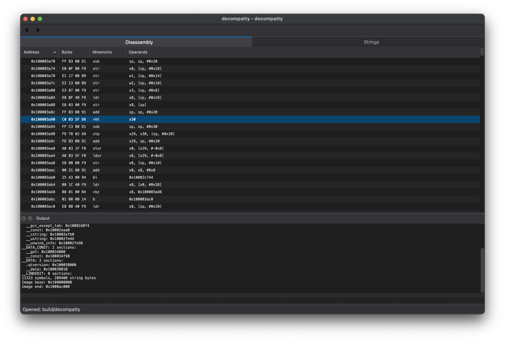
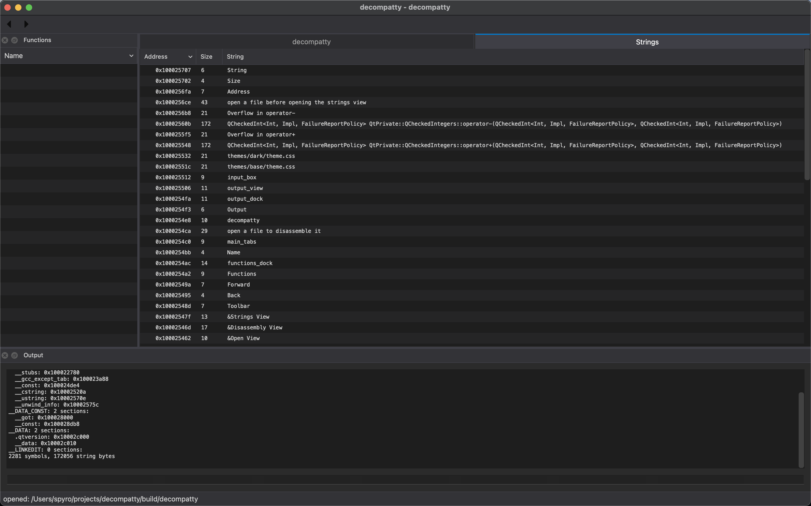

# decompatty

A small Qt-based binary analysis workbench for inspecting executables, heavily inspired by IDA.

## Features

- Opens 32-bit and 64-bit Mach-O binaries in either byte order, including universal / fat binaries
- Detects architecture, bitness, and endianness
- Parses symbols and extracts strings
- Tabbed views (disassembly, strings)
- Dockable panels

## Requirements

- CMake 3.22+
- A C++20 compiler (Clang/GCC)
- LLVM development libraries for the x86_64 disassembly plugin (`brew install llvm` on macOS)
- Qt 6 (Widgets)

## Build

```sh
cmake -S . -B build
cmake --build build
```

## Usage

```sh
./build/decompatty [file]
```

Inside decompatty, use **File > Open** (or Ctrl+O / Cmd+O) to load a binary.
Open views from **View > Open View**

## Screenshots

### Disassembly view


### Strings view

Fat binaries open the first architecture slice by default. The Mach-O parser exposes
its architecture table through `slices()` and accepts a `slice_index` constructor
argument to inspect another slice. File offsets refer to the original fat binary.
Disassembly requires a plugin matching the slice's architecture, bitness, and byte order.

Parser regression checks:

```sh
cmake --build build --target macho_tests
./build/macho_tests
```

The x86_64 plugin uses LLVM and displays Intel syntax. If LLVM is installed in a
custom location, pass `-DLLVM_DIR=/path/to/llvm/lib/cmake/llvm` when configuring.
Undecodable bytes appear as `.byte` rows so disassembly can continue.
The strings view escapes control characters such as `\n`, `\r`, and `\t`.

Strings display and x86_64 plugin checks:

```sh
cmake --build build --target disassembly_tests
QT_QPA_PLATFORM=offscreen ./build/disassembly_tests ./build/arch/arch_x86_64.so
```

Parsing and disassembly run on a background worker. The main Qt thread renders
incoming instruction batches in a table model, with a live instruction count in
the status bar. Opening another file cancels the previous decode. Closing and
reopening the disassembly tab restores the batches already received.

Threading and incremental display checks:

```sh
cmake --build build --target async_tests
QT_QPA_PLATFORM=offscreen ./build/async_tests ./build/arch
```

The disassembly listing uses segment-prefixed addresses, separate symbol labels,
and syntax colors for registers, constants, and control flow. Toggle **Opcode
bytes** to show the encoding, press **G** to jump to an already decoded address,
and use **Ctrl+C** / **Cmd+C** to copy the selected line.

Choose **View → Theme** to switch between Dark, Light, Nord, Dracula, Gruvbox,
and Solarized. The selected theme is saved when the app exits and restored on
the next launch, with Dark as the fallback if it is unavailable. Themes live in `themes/<name>/theme.css` and share the layout rules
in `themes/base/theme.css`. Add another theme directory to include it in the menu
on the next launch. The application can load its bundled themes from any working
directory; a local `themes` directory takes precedence.

Disassembly syntax is styled through `disassembly_view_t` properties:
`qproperty-addressColor`, `qproperty-bytesColor`, `qproperty-labelColor`,
`qproperty-mnemonicColor`, `qproperty-registerColor`, `qproperty-immediateColor`,
and `qproperty-controlColor`. Omitted colors fall back to the text palette;
selection follows the theme's highlighted text color.

Open **Edit → Threading settings…** to enable parallel disassembly, choose an
explicit worker limit (1–64) or Automatic, set the decode batch size (4, 16, or
64 KiB), and limit pending UI updates (1–64). Settings are saved per user and
apply when the next file opens. Parallel disassembly is off by default; parsing
and decoding still use a background worker so the UI remains responsive.

ARM64 work is divided at fixed-width instruction boundaries. x86_64 work uses
`LC_FUNCTION_STARTS` boundaries and falls back to one decoder when sufficient
boundaries are unavailable. Each worker owns its decoder, and results reach the
listing in address order through bounded queues. Automatic uses up to the logical
CPU count minus one, with a minimum of one and a maximum of 64 decoder workers.
The Output pane reports the actual decoder count used for each section.
